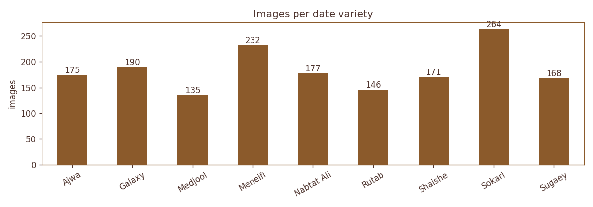
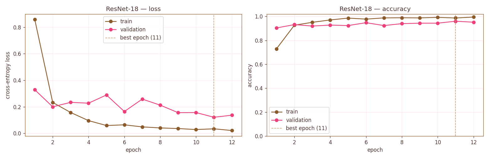
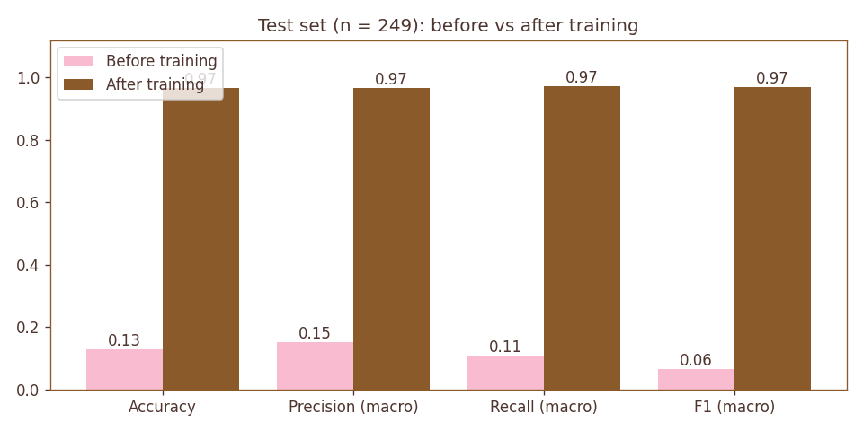
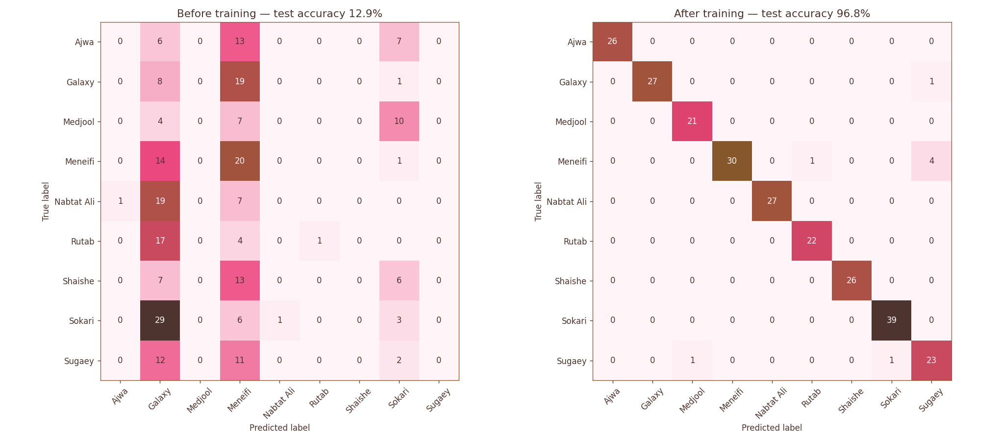
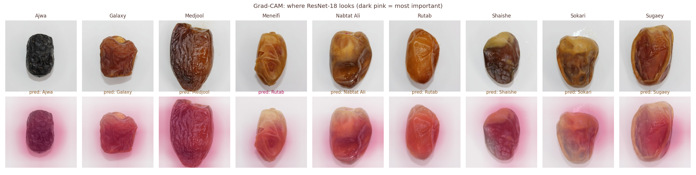
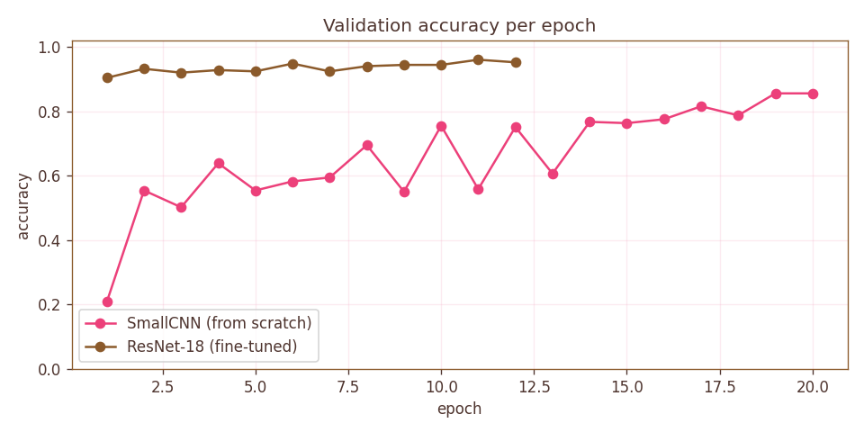
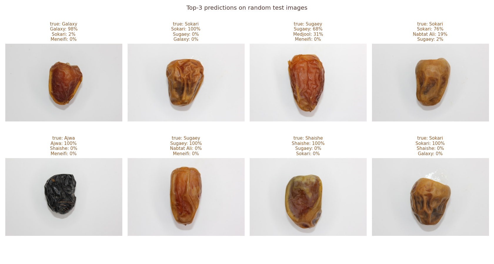

# 🌴 Saudi Date Fruit Classifier

**Fine-tuning a pretrained ResNet-18 to recognise 9 varieties of Saudi dates from a single photo.**

*Computer Vision for Developers, SDAIA Academy*
**Team:** Wejdan Alotaibi

[](https://colab.research.google.com/github/wejdanturki7/SaudiDatesClassifier/blob/main/project.ipynb)

> **Result:** test accuracy went from **12.9 %** before training (random guessing for 9 classes is 11.1 %) to **96.8 %** after **1.5 minutes** of fine-tuning on a T4 GPU. Only 8 of the 249 test images were misclassified.


---

## Project

Saudi Arabia is one of the world's largest date producers, with hundreds of varieties. Telling them apart (for example Ajwa vs. Sokari vs. Medjool) matters for sorting lines, markets, pricing and quality control, and today a trained human usually does it by eye.

We train an image classifier that takes **one photo of a single date** and predicts its **variety (9 classes)**. The pipeline:

1. Download the Kaggle dataset, resize every photo once and remove exact duplicates (MD5 hash).
2. Make a stratified **train / validation / test** split (70 / 15 / 15). The test set is touched only twice.
3. Evaluate on the test set **before training** (≈ random guessing, 1/9).
4. Fine-tune a **pretrained ResNet-18** with a new 9-class head (Day 2 technique, Lab 2B).
5. Plot loss and accuracy per epoch.
6. Evaluate **after training** on the same test set with the same metrics, then compare.
7. Analyse the errors with a confusion matrix, a gallery of the mistakes and **Grad-CAM** heat-maps.
8. **Bonus:** compare against a small CNN trained from scratch (Day 1 technique, Lab 1B).

## Dataset

| | |
|---|---|
| **Name** | Date Fruit Image Dataset in Controlled Environment |
| **Link** | https://www.kaggle.com/datasets/wadhasnalhamdan/date-fruit-image-dataset-in-controlled-environment |
| **Authors** | W. Alhamdan & J. M. Howe, City, University of London (2021) |
| **Content** | Photos of single date fruits taken with a DSLR camera (5184 × 3456 px) in a controlled environment (same background and lighting) |
| **Task** | Image classification, 9 classes |
| **Images** | **1,658** (0 exact duplicates, 0 unreadable files) |

**Varieties:** Ajwa (عجوة) · Galaxy (جالكسي) · Medjool (مجدول) · Meneifi (منيفي) · Nabtat Ali (نبتة علي) · Rutab (رطب) · Shaishe (شيشي) · Sokari (سكري) · Sugaey (صقعي)

**Split per class** (stratified, seed 42):

| Variety | train | val | test | total |
|---|---|---|---|---|
| Ajwa | 122 | 27 | 26 | 175 |
| Galaxy | 133 | 29 | 28 | 190 |
| Medjool | 94 | 20 | 21 | 135 |
| Meneifi | 162 | 35 | 35 | 232 |
| Nabtat Ali | 124 | 26 | 27 | 177 |
| Rutab | 102 | 22 | 22 | 146 |
| Shaishe | 120 | 25 | 26 | 171 |
| Sokari | 185 | 40 | 39 | 264 |
| Sugaey | 118 | 25 | 25 | 168 |
| **TOTAL** | **1160** | **249** | **249** | **1658** |



The classes are a little unbalanced: Sokari has 264 images and Medjool has 135. That's why we report **macro** precision, recall and F1, which give every variety the same weight.

**Preprocessing**
- Every photo is resized once so its shorter side is 256 px. This makes each epoch fast.
- Exact duplicates are removed **before** splitting, so the same image can't end up in both train and test.
- Validation is used to pick the best epoch. Test is used only before and after training.
- Training augmentation: random resized crop, horizontal and vertical flips, ±20° rotation, and mild brightness/contrast changes. We leave **hue** unchanged because colour is a key clue that separates varieties.

## Model

- **Backbone:** ResNet-18 pretrained on ImageNet (`torchvision`).
- **Head:** the original `fc` layer (512 → 1000) is replaced by a new `Linear(512 → 9)`.
- **Fine-tuning:** all layers are trained, with two learning rates. The new head uses `1e-3` because it starts from random weights. The pretrained backbone uses `1e-4` because it only needs small adjustments.
- **Checkpoint:** we keep the weights from the epoch with the best validation accuracy.

| Setting | Value |
|---|---|
| Model | ResNet-18 (ImageNet weights) + new Linear(512 → 9) head |
| Parameters | 11.18 M |
| Input size | 224×224 |
| Batch size | 32 |
| Epochs | 12 |
| Learning rate | 0.0001 (backbone) / 0.001 (head) |
| Optimizer | AdamW (weight decay 0.0001) + cosine schedule |
| Loss | CrossEntropyLoss |
| Weights kept | best validation epoch (11) |
| Training time | 1.5 min on a Tesla T4 GPU |

## Results

### Training curves



The pretrained features make learning very fast. Validation accuracy is already 90.4 % after the first epoch and peaks at 96.0 % at epoch 11, the weights we keep. Training loss keeps falling (to 0.02). Validation loss moves up and down between 0.12 and 0.29 but reaches its lowest value (0.12) at that same epoch, so the gap stays small and the model is not seriously overfitting.

### Before vs. after training (same test set, n = 249)

| Metric (test set) | Before training | After training | Change |
|---|---|---|---|
| Loss | 2.3584 | 0.1064 | -2.2520 |
| Accuracy | 0.1285 | 0.9679 | +0.8394 |
| Precision (macro) | 0.1521 | 0.9675 | +0.8154 |
| Recall (macro) | 0.1088 | 0.9713 | +0.8624 |
| F1 (macro) | 0.0646 | 0.9683 | +0.9037 |



Before training, the new 9-class head had random weights, so the model was close to guessing. It scored 12.9 % accuracy (chance is 11.1 %) and a loss of 2.36 (≈ ln 9 = 2.20), which also confirms that no test images leaked into training. After fine-tuning, the same 249 test images reach **96.8 % accuracy** and **0.968 macro F1**, and the loss drops to 0.106. Because ResNet-18 already knows edges, textures and shapes from ImageNet, it only had to learn the new head and adjust its layers slightly to separate the 9 varieties.

### Confusion matrix and errors



| Variety | Precision | Recall | F1 | Test images |
|---|---|---|---|---|
| Ajwa | 1.000 | 1.000 | 1.000 | 26 |
| Galaxy | 1.000 | 0.964 | 0.982 | 28 |
| Medjool | 0.955 | 1.000 | 0.977 | 21 |
| Meneifi | 1.000 | 0.857 | 0.923 | 35 |
| Nabtat Ali | 1.000 | 1.000 | 1.000 | 27 |
| Rutab | 0.957 | 1.000 | 0.978 | 22 |
| Shaishe | 1.000 | 1.000 | 1.000 | 26 |
| Sokari | 0.975 | 1.000 | 0.987 | 39 |
| Sugaey | 0.821 | 0.920 | 0.868 | 25 |

Only **8 of 249** test images are wrong. The main confusion is **Meneifi predicted as Sugaey (4 times)**. Both are amber-brown, wrinkled dates of similar size and shape, so Meneifi has the lowest recall (0.857) and Sugaey has the lowest precision (0.821). Ajwa, Nabtat Ali and Shaishe are perfect (F1 = 1.000). Ajwa's almost-black colour makes it the easiest variety to recognise.


Most mistakes have low confidence (55–77 %), so the model "knows" these images are hard. Only two mistakes have high confidence: Sugaey predicted as Sokari (99 %) and Meneifi predicted as Sugaey (91 %).

### What the model looks at (Grad-CAM)



Dark-pink areas are the pixels that pushed the model towards its answer. In almost every example, the strongest heat sits on the **fruit itself** (skin texture, wrinkles, colour) and not on the white background, so the model learned real date features instead of shortcuts.

### Bonus: transfer learning vs. training from scratch

| Model | Pretrained | Parameters (M) | Epochs | Train time (min) | Test accuracy | Test F1 (macro) |
|---|---|---|---|---|---|---|
| SmallCNN (from scratch) | no | 0.39 | 20 | 2.3 | 0.8273 | 0.8288 |
| ResNet-18 (fine-tuned) | yes (ImageNet) | 11.18 | 12 | 1.5 | 0.9679 | 0.9683 |



The small CNN trained from scratch reaches 82.7 % test accuracy after 20 epochs. The fine-tuned ResNet-18 reaches 96.8 % with fewer epochs and less time, **14.1 points better**. The from-scratch curve also jumps up and down a lot from epoch to epoch. With only 1,160 training images, pretrained ImageNet features make a big difference.

### Predictions on test images



### Limitations and next steps

- All photos come from one controlled setup, so real-world phone photos (different light and background) will probably score lower. Next step: test on our own photos from the market. The notebook has an upload cell for this.
- Some photos may show the same fruit from different sides. If those land in different splits, the test score could be a little optimistic.
- To fix the Meneifi / Sugaey confusion: collect more images of these two varieties, or train at a higher resolution so finer skin texture is visible.
- Future work: add more popular Saudi varieties (Khalas, Barhi, Segae…), and export the model to a mobile app.

## How to run

1. Click **Open in Colab** above, or upload `project.ipynb` to [Google Colab](https://colab.research.google.com).
2. Go to **Runtime → Change runtime type → T4 GPU**.
3. Get a Kaggle API token: kaggle.com → *Settings* → *API* → **Create New Token**.
4. In Colab, open **Secrets** (🔑 in the left sidebar). Add `KAGGLE_USERNAME` and `KAGGLE_KEY`, and switch on *Notebook access*. Never put the key in the notebook.
5. Go to **Runtime → Run all**. The dataset downloads automatically with `kagglehub`, and the whole notebook runs in a few minutes.
6. The notebook writes these outputs:
   - `figures/`: all the plots used in this README
   - `results/metrics.json`: every metric and the per-epoch history
   - `results/README_results.md`: the tables used in this README
   - `project_outputs.zip`: the figures and results, downloaded automatically

The dataset is **not** stored in this repo. It is downloaded at run time.

## Repository structure

```
├── README.md
├── project.ipynb      # full pipeline, saved with outputs
├── figures/           # plots produced by the notebook
├── results/           # metrics.json + README_results.md produced by the notebook
└── .gitignore         # keeps the dataset and model weights out of git
```

## Acknowledgements

- Dataset: W. Alhamdan and J. M. Howe, *Classification of date fruits in a controlled environment using Convolutional Neural Networks* (2021).
- Course: *Computer Vision for Developers*, Musa Ibn Rashid, SDAIA Academy.
