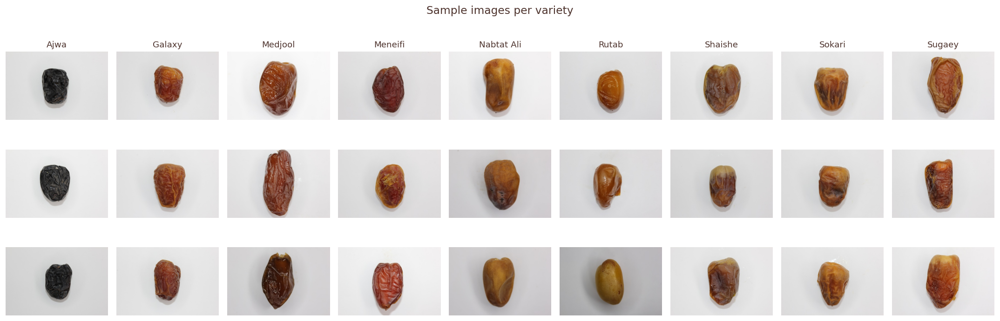
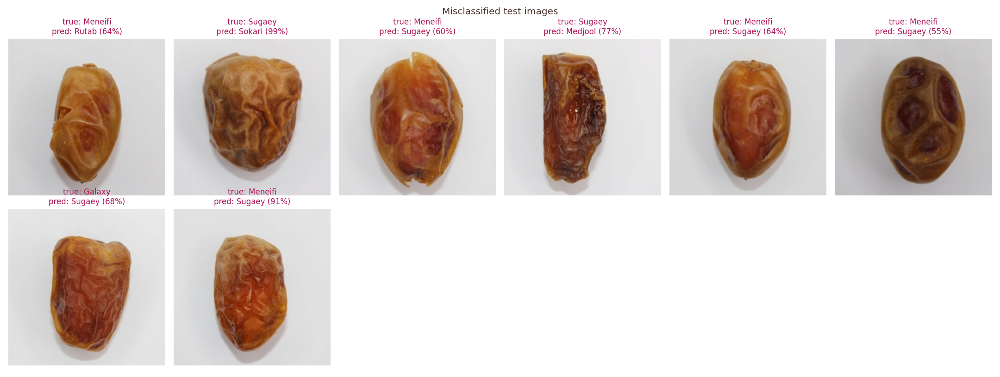

# Saudi Date Fruit Classifier

Computer Vision for Developers – SDAIA Academy
Team: Wejdan Alotaibi

[](https://colab.research.google.com/github/wejdanturki7/SaudiDatesClassifier/blob/main/project.ipynb)



## Project

I chose Saudi dates for this project because dates are an important part of Saudi culture and daily life. Saudi Arabia has many different types of dates, and some of them look very similar to each other. I wanted to explore how computer vision can help identify these varieties using images instead of relying only on human observation.

In this project, I used a pretrained ResNet-18 model and fine-tuned it to classify nine types of Saudi dates. My goal was to see how well the model could learn the visual differences between the varieties, such as colour, shape, and texture.

Steps in the notebook:

1. Download the dataset from Kaggle, resize the images and check for duplicates.
2. Split the data into train / validation / test (70 / 15 / 15).
3. Evaluate the model on the test set before training.
4. Fine-tune ResNet-18 with a new 9-class output layer.
5. Plot loss and accuracy per epoch.
6. Evaluate again on the same test set and compare before vs after.
7. Look at the errors: confusion matrix, misclassified images and Grad-CAM.
8. Extra: compare with a small CNN trained from scratch.

## Dataset

| | |
|---|---|
| Name | Date Fruit Image Dataset in Controlled Environment |
| Link | https://www.kaggle.com/datasets/wadhasnalhamdan/date-fruit-image-dataset-in-controlled-environment |
| Authors | W. Alhamdan & J. M. Howe (2021) |
| Images | 1,658 photos of single dates (DSLR, 5184 × 3456 px, same background and lighting) |
| Classes | 9 |

Varieties: Ajwa (عجوة), Galaxy (جالكسي), Medjool (مجدول), Meneifi (منيفي), Nabtat Ali (نبتة علي), Rutab (رطب), Shaishe (شيشي), Sokari (سكري), Sugaey (صقعي)

Split per class (stratified, seed 42):

| Variety | train | val | test | total |
|---|---|---|---|---|
| Ajwa | 122 | 27 | 26 | 175 |
| Galaxy | 133 | 29 | 28 | 190 |
| Medjool | 94 | 20 | 21 | 135 |
| Meneifi | 162 | 35 | 35 | 232 |
| Nabtat Ali | 124 | 26 | 27 | 177 |
| Rutab | 102 | 22 | 22 | 146 |
| Shaishe | 120 | 25 | 26 | 171 |
| Sokari | 185 | 40 | 39 | 264 |
| Sugaey | 118 | 25 | 25 | 168 |
| TOTAL | 1160 | 249 | 249 | 1658 |


Notes:
- No duplicate or broken images were found.
- The classes are not perfectly balanced (Sokari 264, Medjool 135), so I report macro precision, recall and F1.
- Images were resized once (shorter side 256 px) to make training faster.
- Training augmentation: random crop, flips, rotation and small brightness/contrast changes. I did not change the hue, because colour is important for telling the varieties apart.
- The test set was only used twice: before and after training.

## Model

ResNet-18 pretrained on ImageNet. I replaced the last layer (512 → 1000) with a new layer (512 → 9) and fine-tuned the whole network. The new layer uses a higher learning rate because it starts from random weights.

| Setting | Value |
|---|---|
| Model | ResNet-18 (ImageNet weights) + new Linear(512 → 9) |
| Parameters | 11.18 M |
| Input size | 224×224 |
| Batch size | 32 |
| Epochs | 12 |
| Learning rate | 0.0001 (backbone) / 0.001 (new layer) |
| Optimizer | AdamW (weight decay 0.0001) + cosine schedule |
| Loss | CrossEntropyLoss |
| Weights kept | best validation epoch (11) |
| Training time | 1.5 min on a Tesla T4 GPU |

## Results

### Training curves


Validation accuracy was already 90.4% after the first epoch and reached its best value (96.0%) at epoch 11. The training and validation curves stay close, so the model did not overfit much.

### Before vs after training (same test set, 249 images)

| Metric (test set) | Before training | After training | Change |
|---|---|---|---|
| Loss | 2.3584 | 0.1064 | -2.2520 |
| Accuracy | 0.1285 | 0.9679 | +0.8394 |
| Precision (macro) | 0.1521 | 0.9675 | +0.8154 |
| Recall (macro) | 0.1088 | 0.9713 | +0.8624 |
| F1 (macro) | 0.0646 | 0.9683 | +0.9037 |


### Confusion matrix and per-class results


| Variety | Precision | Recall | F1 | Test images |
|---|---|---|---|---|
| Ajwa | 1.000 | 1.000 | 1.000 | 26 |
| Galaxy | 1.000 | 0.964 | 0.982 | 28 |
| Medjool | 0.955 | 1.000 | 0.977 | 21 |
| Meneifi | 1.000 | 0.857 | 0.923 | 35 |
| Nabtat Ali | 1.000 | 1.000 | 1.000 | 27 |
| Rutab | 0.957 | 1.000 | 0.978 | 22 |
| Shaishe | 1.000 | 1.000 | 1.000 | 26 |
| Sokari | 0.975 | 1.000 | 0.987 | 39 |
| Sugaey | 0.821 | 0.920 | 0.868 | 25 |

Misclassified test images (8 of 249):



### Results interpretation

The results showed a big improvement after training the model. Before training, the accuracy was only 12.9%, which was close to random guessing. After fine-tuning ResNet-18, the accuracy increased to 96.8% on the test set. This means the model correctly classified 241 out of 249 test images.

The model performed very well on most date varieties. Ajwa, Nabtat Ali, and Shaishe achieved perfect F1-scores. However, the model sometimes confused Meneifi with Sugaey because they have similar colours and shapes. This shows that some date varieties are harder to distinguish from images alone.

Overall, the results show that transfer learning helped the model learn the differences between Saudi date varieties in a short training time.

### Grad-CAM


Grad-CAM shows which part of the image the model used for its prediction (dark pink = most important). In most examples the model focuses on the date itself, not the background.

### Extra: pretrained vs from scratch

| Model | Pretrained | Parameters (M) | Epochs | Train time (min) | Test accuracy | Test F1 (macro) |
|---|---|---|---|---|---|---|
| SmallCNN (from scratch) | no | 0.39 | 20 | 2.3 | 0.8273 | 0.8288 |
| ResNet-18 (fine-tuned) | yes (ImageNet) | 11.18 | 12 | 1.5 | 0.9679 | 0.9683 |


The small CNN trained from scratch reached 82.7% test accuracy, compared to 96.8% for the pretrained ResNet-18.

### Personal observation

One thing I noticed during this project is that Ajwa dates were easier for the model to recognize, possibly because of their very dark colour. I also noticed that Meneifi and Sugaey were more difficult to distinguish because they share similar colours and shapes. This helped me understand why some varieties were confused by the model.

### Limitations and next steps

- All images were taken in the same controlled setup, so the model may not work as well on normal phone photos.
- Some images may show the same date from different sides, which could make the test score a bit optimistic.
- Next steps: test on my own phone photos, collect more Meneifi and Sugaey images, and add more varieties like Khalas and Barhi.

## How to run

1. Open `project.ipynb` in Google Colab (button above).
2. Runtime → Change runtime type → T4 GPU.
3. Get a Kaggle API token (kaggle.com → Settings → API → Create New Token).
4. In Colab Secrets (key icon on the left), add `KAGGLE_USERNAME` and `KAGGLE_KEY` and turn on notebook access.
5. Runtime → Run all. The dataset is downloaded automatically with `kagglehub`.

The notebook saves the plots in `figures/` and the metrics in `results/`. The dataset is not included in this repo.

## Repository structure

```
├── README.md
├── project.ipynb      # notebook with outputs
├── figures/           # plots from the notebook
├── results/           # metrics.json + README_results.md
└── .gitignore
```

## Acknowledgements

- Dataset: W. Alhamdan and J. M. Howe, Classification of date fruits in a controlled environment using Convolutional Neural Networks (2021).
- Course: Computer Vision for Developers, Musa Ibn Rashid, SDAIA Academy.
